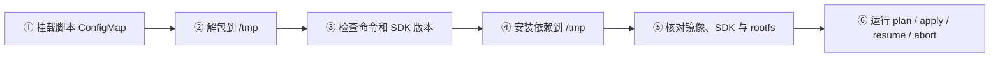
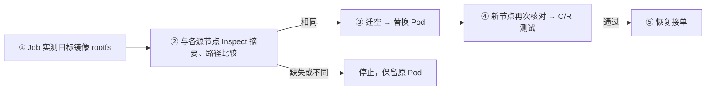

# akernel-node 镜像升级执行器

`deploy/upgrade/manage.py` 按“迁出 Sandbox → 验空 → 替换 Pod → 测试并开放”逐节点执行。默认命令是只读 `plan`；所有写入命令必须显式传 `--execute`。执行器与 Job 已有本地失败场景测试，尚未完成真实集群升级验收。

## 前置条件

- 原节点、目标节点及 Coordinator 已部署支持 `/v1/node-upgrades/` 的管理协议，包含 `canary_cleanup`、`runtime_rootfs_identity` 能力；首次能力上线从空载节点引导。Helm 使用 `core.adx.management.enabled=true` 启用集群内 `19092` 管理端口及 NetworkPolicy，要求 CNI 执行策略；同 namespace 的升级 Job 和 scaling-controller 标签获得访问，不能公开转发该端口。
- 原生 `apps/v1` DaemonSet、至少两个节点、共享 checkpoint alias、兼容且固定的 runtime/rootfs。新旧 node 镜像均用 `@sha256:` 固定，配置变更或未知资源会停止任务。
- scaling-controller 已启用升级交接协议，预先提供 `<stateConfigMap>-upgrade` ConfigMap；控制器必须先确认本任务/epoch 的 `handoff=Ready`。Active 期间禁止缩容、保留扩容；Finalizing 收尾阶段短暂禁止新扩容调用，既有扩容继续对账和验收，Released 后恢复原策略。
- 一次任务只处理一个 DaemonSet。普通业务扩容与容量请求的新增节点都须由 scaler up journal 证明归属，并执行同一套测试；外部 DaemonSet 或无操作归属的新节点保持阻塞，不能由本任务自动放行。
- Job 复用的 node 镜像包含 `python3`、`python3-pip`（当前构建已包含），且 Job 可访问所用 PyPI 索引及下载源；SDK 支持 ADX 后端和 `Sandbox(node_id=...)`。执行器直接使用 SDK，不另实现命令或文件协议。
- 公网资源查询使用 HTTPS 与现有 token/CA 文件；内部 management 请求不携带公网 bearer。不要把 Secret 值写入配置、命令行或日志。

## 配置与只读检查

```bash
python3 -m pip install -r deploy/upgrade/requirements.txt
python3 -m pip install --upgrade --pre akernel-sdk
cp deploy/upgrade/config.example.json /protected/path/upgrade.json
python3 deploy/upgrade/manage.py plan --config /protected/path/upgrade.json --kubeconfig /protected/path/kubeconfig
python3 deploy/upgrade/manage.py status --config /protected/path/upgrade.json --kubeconfig /protected/path/kubeconfig
```

新任务通过下文 Job 执行；本地 `plan` 会列出缺少目标镜像实测 rootfs 的阻塞项，`status` 可正常只读查询。

先填写示例中的实际 namespace、DaemonSet、镜像 digest、管理/公开地址、共享存储 alias、scaler cluster/pool 与凭据路径。`capacity_requests.count` 来自配置中的 `scaler.count`，由运维按源节点负载及池模板设置。执行器不直接调用云 API。

需要先预留备用容量时，设置 `upgrade.prewarm_capacity=true`（默认关闭）。Job 发布隔离的新镜像模板后，按 `scaler.count` 申请一次扩容，完成新增节点的 C/R 测试并取得该请求的 Completed 回执后，才迁出首个源节点。中断续做复用同一请求，不重复购买；池上限须包含备用容量，例如 5 台基线加 1 台备用时设为 6。

`apply` 在 ConfigMap 保存唯一 DaemonSet 任务进度，持久化每个迁移和删除意图。它先确认 OnDelete，再增加新进程的默认隔离环境，最后更新 node 镜像。任务内每轮重新读取全部资源及实例分页；实例分页 epoch/revision 漂移不视为空载。

取得 scaler Ready 后，首次 begin/发布前重新核对并持久固定 Pod 基线，纳入交接期间已完成扩容的旧镜像节点；已有原 Pod UID/session 不会被刷新覆盖，续做也不会重新采集基线。其后出现的节点必须有 scaler 精确扩容归属，并重新读取 Kubernetes Node 核对 UID、池与实例身份。晚到的旧镜像 Pod 加入同一源节点队列，逐一迁出和升级；新镜像 Pod 才走隔离验收。收尾期间发现旧源会回到队列，不能提前结束任务；无归属节点继续阻塞。

任务同时固定镜像、共享 checkpoint alias、DaemonSet/container、资源预算和 scaler cluster/pool/ConfigMap 等配置；`resume`、`abort` 在任何写入前校验，配置漂移会停止。轮询间隔和超时预算可调整。

容量检查每轮使用源节点当前的占用量和目标可分配量，包含此前迁入该源节点的负载。普通资源投影因管理员暂停而归零时，读取内部管理 Inspect 的真实资源账本，校验后计算占用（CPU 保留毫核，内存/磁盘占用向上取整为 MiB），保留原暂停状态；账本读取失败、字段缺失或非法时阻塞。该检查是总量预检，不能替代每个实例的调度约束及实时 Admission；目标容量未提前预留，竞争仍可能使已 Pause 的实例等待。

目标资源连续不足 60 秒后，写入稳定 request ID 的容量请求并继续等待；超过节点操作预算则停止并保留请求和保护。扩容节点达到 `ReadyForValidation`、Pod 基础健康及实际 imageID 匹配后即可测试；不等待依赖“测试后开放”的 scaler `Completed` 状态。测试会先在健康 B 上用 SDK 创建固定身份，写文件，再通过管理迁出接口在待验 A 恢复，并通过原 SDK 入口验证命令与文件，最后删除测试实例。只有管理端重新验空、撤销执行/删除许可并验证当前 session 后，才恢复 A 原有调度状态。

## Job

Job 使用配置中待升级的目标 akernel-node 镜像及相同 digest，无须单独构建 Job 镜像。Job 覆盖镜像启动命令，只运行升级脚本，不启动 node 服务。启动流程：



在仓库根目录生成脚本清单，**此命令不访问集群**：

```bash
python3 deploy/upgrade/scripts_configmap.py --namespace akernel > /tmp/akernel-node-upgrade-scripts.json
python3 -c 'import json; print(json.load(open("/tmp/akernel-node-upgrade-scripts.json"))["metadata"]["name"])'
```

生成的 ConfigMap 设置 `immutable: true`，名称包含脚本内容摘要。仅包含 bootstrap、执行器 Python 包和依赖清单，不包含测试、配置或凭据。脚本有变更时生成新名称；同一任务续做仍使用原 ConfigMap。

准备 `deploy/upgrade/job.yaml` 时填写：

| 项目 | 设置 |
| --- | --- |
| `image` | 与 `upgrade.image` 相同的目标 node 镜像 `@sha256:...`；Job 实测镜像内 rootfs，不能用另一镜像代替 |
| 私有镜像凭据 | 在 Job 的 `imagePullSecrets` 或其 ServiceAccount 配置现有拉取 Secret；不会继承 node DaemonSet 的设置 |
| `volumes.scripts.configMap.name` | 上一步打印的脚本 ConfigMap 名称；部署时先创建该 ConfigMap，再创建 Job |
| 配置 / 凭据 | 现有配置 ConfigMap、凭据 Secret 及其文件路径；示例不创建或修改 Secret |
| 命令和版本 | 先运行默认 `plan`，从日志记录 `akernel-sdk=<version>`；写入命令须填 `AKERNEL_SDK_VERSION=<version>`，并传 `--execute` |

例如正式执行时设置 `args: [apply, --execute, --config, /etc/akernel-upgrade/config.json]`。`resume`、`abort` 使用相同格式，并换用新的 Job 名称；先确认旧执行 Pod/进程已退出，不能只看 Job 已标记失败或 Pod 正在 Terminating。

首次 `apply` 将实际脚本内容摘要、实际安装的 SDK 版本、执行 Pod 的镜像 digest 和 rootfs SHA-256 保存到任务 ConfigMap。镜像通过 Downward API 的 Pod name/UID 和现有 `pods/get` 权限读取，并检查实际 imageID；rootfs 读取镜像内固定文件，禁止挂载覆盖该文件或其父目录。`resume/abort` 在任何写入前比对这些身份；SDK、脚本内容、执行镜像变化或缺失都会停止，包括同名脚本 ConfigMap 被删除后换内容重建。新 Job 的名称和 Pod UID 可以变化，task/executor ID、脚本、SDK、镜像及任务配置须保持原值；已有任务继续用原脚本，不用新脚本接管。

未填 SDK 版本、依赖安装失败或当前执行 Pod 已进入删除时，在调用升级接口前退出；仍会检查 SDK 的 ADX / `node_id` 能力。本地直接运行 `manage.py` 时由操作者固定依赖环境；缺少 Job 环境身份的本地进程不能续做已记录该身份的 Job 任务，`status` 仍可只读查询。

`plan/status` 未指定 SDK 版本时，启动时从 PyPI 选择最新可用版本，包含 RC；已指定版本时安装该精确版本。依赖统一安装到 `/tmp`，使用 `python3 -S` 和独立依赖目录运行，避免混用 node 镜像内的 SDK。保留非 root、只读根文件系统和原有最小权限，无须安装系统软件或启用特权。`pip --no-cache-dir` 关闭 pip 缓存，每个新 Pod 都要重新下载依赖；因此需要网络，且仅固定 SDK 版本并不等于锁定全部传递依赖。

`deploy/upgrade/job.yaml` 提供 ServiceAccount、namespace Role/RoleBinding、只读 Node 的 ClusterRole/ClusterRoleBinding。更换 namespace 时同步修改全部资源、绑定的 ServiceAccount namespace 及 ClusterRoleBinding 名称。管理监听的 NetworkPolicy 由 ADX 部署维护。

独立 `deploy/upgrade/Dockerfile` 保留用于只读查询；它不包含目标 node 的 rootfs，不能启动新的升级任务。本文 Job 模板及环境身份检查采用上述复用方案。该 Dockerfile 构建时从 PyPI 安装 SDK（含 RC）；`pip --no-cache-dir` 不会禁用 Docker 层缓存，需要重新查询最新版时使用 `docker build --no-cache -f deploy/upgrade/Dockerfile -t <executor-image> .`。

Helm 的 `core.node.updateStrategy=OnDelete` 可用于保留执行器设置，后续 Helm 更新须避免恢复自动滚动。

Job 默认执行 `plan`，`restartPolicy: Never`、`backoffLimit: 0`。Role 仅提供目标 DaemonSet 的 get/patch，以及本 namespace 的 Pod 和任务 ConfigMap 权限；ClusterRole 仅提供 Node get，不提供节点写入或云权限。

测试实例使用保留的 `upgrade-canary-` 名称。清理统一等待 ADX `revoke-canary` 撤销创建/执行授权并确认实际清理；SDK 删除返回成功或 404 均不能代替这份确认。创建回复丢失、回滚或 Pod UID 变化时，同样先处理旧测试身份。

## rootfs 兼容性预检

只更换 node/ADX 时，通过 [构建说明](../../builder/README.md) 的 `AKERNEL_RUNTIME_SOURCE_IMAGE` 和 `AKERNEL_RUNTIME_ROOTFS_SHA256` 复用原 rootfs。重新执行 `mkfs.erofs` 即使软件版本相同，也可能改变 UUID、时间戳或内容，从而使 runsc 拒绝恢复。



预检在创建任务前、交接/续做、迁出/删除前和新节点验收时执行；ADX 也在迁移及 canary 授权时核对源、目标，避免新增节点绕过检查。目前仅覆盖固定路径 `/opt/akernel/runtime/akernel-runtime-rootfs.img` 的默认本地 EROFS profile；自定义 image/rootfs 不在本升级流程范围内。摘要相同只是必要条件，不能替代 runtime、CPU/内核兼容性和真实 C/R 测试。

## 停止、续做和回退

只读管理和资源查询对瞬态故障最多尝试 4 次，退避共用原读取预算，并遵守预算内的 `Retry-After`；写操作不自动重放。持续失败仍保留任务状态并退出，不将查询失败视为空载。

Job 收到 SIGTERM 后退出；安装期间同时终止并回收 pip，不会继续启动升级执行器。临时依赖目录随失败清理，每次新 Pod 重新安装。**安装失败不会解除已存在任务的隔离或缩容保护。**

| 中断位置 | 重启方式 |
| --- | --- |
| 依赖安装阶段，尚未创建任务状态 | 修复网络/挂载后，用原环境重新执行 `apply --execute` |
| 已创建任务状态，或是否开始执行不确定 | 先用 `status` 核对；保留脚本、配置和任务 ConfigMap，用同 task/executor ID 执行 `resume --execute` 或 `abort --execute`，不重新 `apply` |

| 操作 | 行为 |
| --- | --- |
| `resume --execute` | 沿同一 task/executor ID 续做；先人工确认上一个执行进程或 Job 已停止。不会自动换主或改变 epoch。 |
| `abort --execute` | 冻结新执行、回退旧模板；只替换管理端证明安全空载的失败 Pod，旧镜像也必须完成测试。 |
| unknown / 权限错误 / 版本冲突 | 停止推进，保留任务及缩容保护，不将错误当作空载。未确认的迁移必须由管理端收敛后才能续做。 |
| 旧 DELETE 结果不明 | 先查询 UID；若同 UID 仍存在，必须未进入 Terminating，CAS 推进 Pod RV 后携原意图 RV 通知管理端撤销旧许可；撤销应答丢失可重放，旧撤销不能清除新许可。 |

当前管理端不提供免 Inspect 回滚凭证。无法 Inspect 时保持隔离和缩容保护，等待恢复管理能力或人工处置；执行器不会自行合成空载证明。rootfs 预检不改变 sandboxd 的 Start/清理协议，也不会自动解除历史 Start 结果不明的状态。已迁出的业务留在目标节点，不随镜像回退恢复旧数据。

迁移意图落盘而服务端尚未接受时，续做先核对同一 task、原 Pod/session 和源实例 generation/revision，再以同一 operation ID 和源版本条件补发；已接受的 Prepared/Assigned 只对账该操作。`abort` 先取得持久 Aborting 确认，阻止迟到的正向请求，再将服务端确认未接受或安全取消的意图记为 Cancelled，不能伪造 Completed；正向升级仍拒绝 Cancelled。身份匹配的服务端 Completed 是已完成迁移的历史事实，用户后续 pause/delete 不会触发重搬；迁移时 Running/Paused 语义以服务端接受记录为准。回退期间新增的旧镜像源只登记并恢复原有调度，不迁移其业务或作为空节点测试。

测试成功后若 verify 应答丢失，即使 Inspect 已显示 verified，续做仍幂等调用 verify 确认原调度状态已恢复；不会重复创建已清理的 canary。

任务释放状态在节点持久保存，现存 Pod 内的 adxlet 重启后保留该结果；若此时已有下一轮升级任务，新会话仍须先隔离，再加载实例清单。

正常完成前先等待容量请求全部确认 Completed，再请求 scaler Finalizing 收尾屏障；回退时允许直接请求 Finalizing，停止购买尚未交付的容量。首次请求前会查看完整归属身份对应的现存 Pod；已出现旧镜像 Pod、但 Pod 或 scaler 基础就绪尚未确认时，保持 Active，在同一收尾预算内等待，再纳入源队列，保留其迁出所需的扩容机会。新镜像待验节点及尚无完整 Kubernetes 身份的未来节点仍由 Finalizing 继续对账。两条路径都必须确认 `observed_phase=Finalizing` 且 `unsettled_up=false`，已提交或结果不明的扩容仍须收敛和验收。随后重新核对 DaemonSet generation/owner Pod UID，恢复模板原有的启动隔离环境，结束 ADX 任务并等待 Released ACK。OnDelete 保留。资源临时足够不跳过尚未完成的扩容验收；未验证的新 UID、尚未收敛的操作、许可或控制器 Create/Delete 结果不明时，不能完成任务。原管理员暂停状态保留。运行时/控制面 pins 不由执行器升级。

## 本地验证

```bash
python3 -m unittest discover -s deploy/upgrade/tests -v
python3 -m compileall -q deploy/upgrade
```

覆盖脚本打包、部分安装失败/终止后重试、SDK/脚本/执行镜像漂移阻断、同环境中断续做不重搬，以及 unknown/Failed 不删除旧 Pod、源归属已空但迁移未完成、SDK 清理应答丢失、UID/RV 与权限冲突、分页漂移、容量请求幂等、迟到 DELETE 撤销和扩容测试交接。还需在实际 node 镜像内验证非 root 启动和依赖下载，再独立完成两主机 C/R、完整 Pod 替换、控制器超时及真实 SDK 网络故障注入，不能以本地测试代替。
