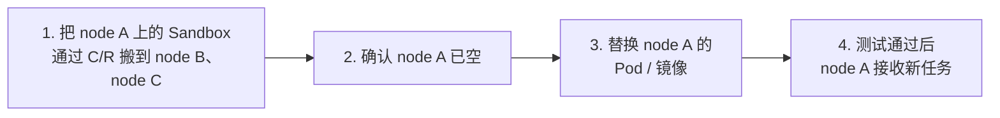
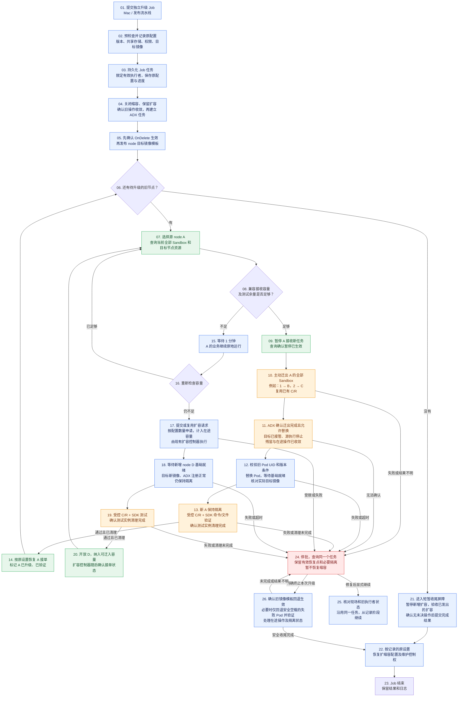
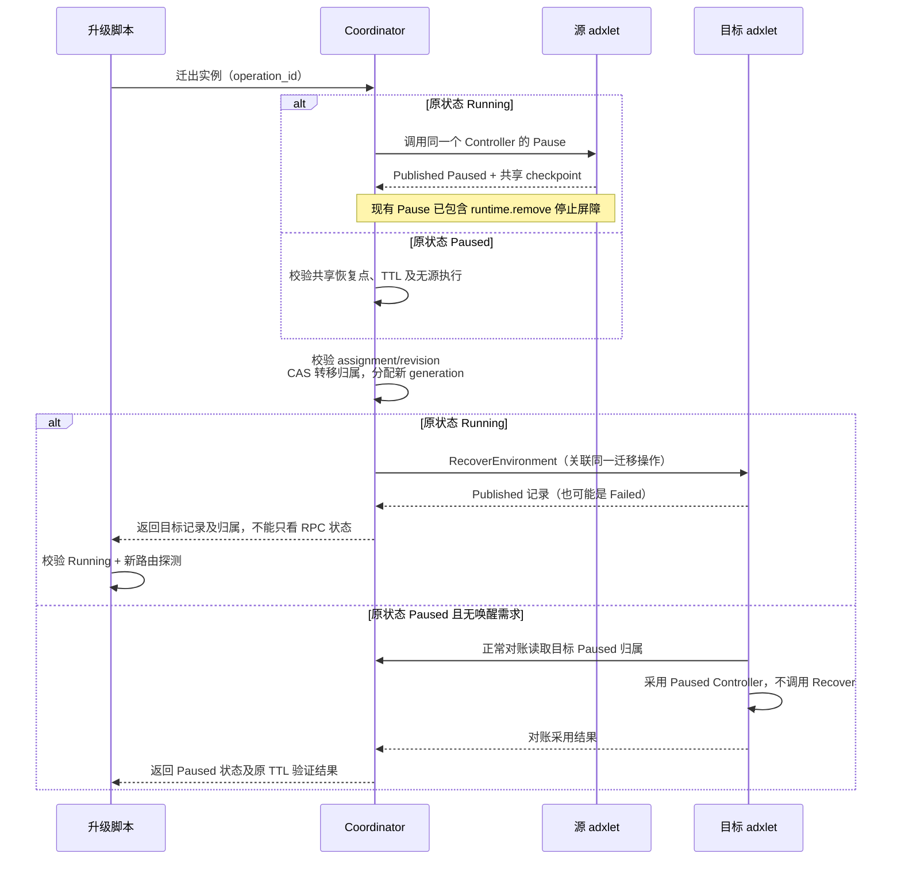

# akernel-node Pod / 镜像滚动升级设计

> 状态：设计与实现评审；接口、Job 和扩缩容协同已落代码，真实集群验收待完成。更新：2026-10-27。
> 使用入口与当前边界见 [升级执行器文档](../../deploy/docs/node-upgrade.md)；当前不支持免 Inspect 回滚或自动换主。

**先把 Sandbox 搬走，再升级已经空下来的节点。**



## 用三个 node 看完整升级过程

假设 node A、node B、node C 都兼容，每台最多容纳 **4 个同规格 Sandbox**。初始共有 Sandbox 1～6；为看清搬迁过程，本例期间不新增业务。表内数字是 Sandbox 编号，“新”表示已升级且测试通过；表中只列业务 Sandbox，测试 Sandbox 验证后会清理。

| 阶段 | node A | node B | node C |
| --- | --- | --- | --- |
| 初始 | 旧：1、2（2/4） | 旧：3、4、5（3/4） | 旧：6（1/4） |
| 第 1 轮：升级 node A 完成 | **新：空（0/4）** | 旧：1、3、4、5（4/4） | 旧：2、6（2/4） |
| 第 2 轮：升级 node B 完成 | 新：1、3、4、5（4/4） | **新：空（0/4）** | 旧：2、6（2/4） |
| 第 3 轮：升级 node C 完成 | 新：1、3、4、5（4/4） | 新：2、6（2/4） | **新：空（0/4）** |

1. **先升级 node A。** node B 只剩 1 个空位，因此把 Sandbox 1 搬到 node B、Sandbox 2 搬到 node C。确认两者恢复成功、node A 已空，再替换 node A 的 Pod / 镜像并测试。
2. **再升级 node B。** 此时 node A 已升级并验证，有 4 个空位；把 node B 当前的 Sandbox 1、3、4、5 全部搬到 node A，确认 node B 已空，再升级并测试 node B。这里包含了上一轮从 node A 搬来的 Sandbox 1。
3. **最后升级 node C。** node A 已满，node B 已升级并验证且有空位，因此把 Sandbox 2、6 搬到 node B，再升级并测试空下来的 node C。

最终三个 node 都是新版本，Sandbox 保持表中最后一行的分布。**升级结束后不额外回迁到最初的节点。** 每个 node 都遵循同样的四步，实际接收位置由当轮容量决定。

## 三个规则

| 规则 | 如何落实 |
| --- | --- |
| **没搬完，不能删旧 Pod。** | 搬迁开始前，源 node 停止接新任务。确认其他 node 已接管、源 node 上的 Sandbox 和残留操作已清空，才允许替换 Pod。 |
| **同一个 Sandbox，不能同时在两个节点运行。** | 先确认源 node 上的执行已停止，再让目标 node 恢复；重复或结果不明的请求不能启动第二份执行。 |
| **新版本没验证通过，不能接业务。** | 升级后的 node 先保持不接业务，用测试 Sandbox 验证恢复、命令和文件访问；测试通过并清理测试实例后，才按原设置恢复接任务。 |

任何一步失败或结果不明，就停止推进：保留有效恢复点，已搬走的业务继续留在接收节点。节点镜像回退的具体条件见实现附录。

## 容量与迁入目标

例子中的“4 个位置”用于说明分布。**单个 node 放不下，可以分散到多个兼容 node；整体仍放不下，就先扩容或等待资源释放，暂不开始这台 node 的搬迁。** 脚本预检 CPU、内存、存储总量和测试余量；ADX 逐实例检查目标硬约束。当前不提前预留容量，预检通过后仍可能因碎片或竞争而等待，不能保证每个实例立即迁出。

后续每轮优先使用已升级且测试通过的 node，并重新检查源 node 的**当前全部负载**，包含前几轮迁入的 Sandbox。升级期间控制新增业务，避免占满后续搬迁所需的余量。

## Job 与脚本完整执行流程

本节描述本次实现的主流程；实际配置和运行边界以升级执行器文档为准。Mac 或发布流水线提交独立 Kubernetes Job，Job 内的升级脚本通过 HTTP 调用 ADX，并通过 Kubernetes API 操作 node DaemonSet 和 Pod。Job 复用固定 digest 的 node 镜像，通过 ConfigMap 挂载脚本，启动时安装依赖；任务固定实际脚本摘要、SDK 版本及执行镜像，续做先校验。使用独立 ServiceAccount，不依赖被替换的 akernel-node Pod。

- **绿色：复用 ADX 已有接口。** 资源和实例查询、暂停与恢复接单已经存在；绿色不代表完整升级功能已经实现。
- **橙色：本次增加的 ADX 升级管理能力。** 包括主动迁出、可靠的迁出完成确认、升级隔离、限定测试授权和任务安全收尾。
- **蓝色：你负责的 Job、脚本及扩容控制器接线。** 包括部署、容量检查、Pod 替换、测试编排和镜像回退。

步骤编号用于评审定位，分支和循环按箭头执行。任何一步失败或结果不明，都进入 **24 停批**；图中仅画出关键异常线。



| 步骤编号 | 阶段 |
| --- | --- |
| 01～05 | 启动 Job、预检、升级保护及模板准备 |
| 06～14 | 逐节点迁出、替换、测试和开放 |
| 15～20 | 容量不足时等待、按需扩容和验证新节点 |
| 21～23 | 成功收尾、恢复原设置及结束 Job |
| 24～26 | 停批、显式继续或安全终止 |

**执行约定：**

- **11 是迁出完成条件的一部分。** 原 Running 实例须确认目标 `Published Running`、地址和本地采用；原 Paused 实例只转归属并保留原 TTL。源节点关闭新增执行、确认迁移完成并严格验空后，才允许替换；不能仅凭实例清单为零删除 Pod。公开入口由受控 SDK 测试和集群验收覆盖。
- **04 通过维护交接暂停缩容，保留原扩容设置。** 关闭缩容不代表已下发的云删除请求撤销，也不保证旧恢复接单流程停止；升级前须确认这些操作已收敛，升级期间不得覆盖 Job 管理的维护状态。22 只恢复本任务接管的设置，保留其他人工维护。
- **17 通过持久容量请求接入现有扩容。** 现有扩容控制器未必能从业务 Pending 或水位识别搬迁缺口；Job 提交带请求 ID 的需求，复用 ACK/ECS 扩容流程，计入在途容量及节点池上限，不每隔一分钟重复扩容。
- **18～20 按“基础就绪 → 验证清理 → 开放”执行。** 新镜像 D 验证后可立即参与容量复检，不等待整个扩容批次完成；若 D 在模板切换前已启动旧镜像，则纳入同一升级队列，先搬走其业务再换 Pod。
- **13、19 的测试复用现有 SDK。** SDK 通过 AKernel API 入口按 `node_id` 定向测试，C/R 测试覆盖从其他节点恢复；ADX 提供本任务、本环境和代次限定的测试授权。测试期间普通业务保持隔离，关闭测试执行豁免、确认清理及当前会话正确后才开放。
- **21 仅在收尾时短暂暂停新扩容。** 已发出的扩容继续观察、验证和接单确认；controller 确认屏障且全部收敛后，才清理启动隔离并完成任务，避免迟到的新节点漏验。
- **24～26 不依赖 Job 自动重试。** 批次顺序、镜像和脚本阶段可由 ConfigMap 记录；ADX 持久保存迁移操作和节点安全状态。同一任务只能有一个有效执行者，接管前先确认旧执行器停止。25 从已确认阶段继续，不一律重新迁出；暂停或 Job 退出不触发 22。

## 模块改动

| 模块 | 是否改 | 改什么 / 复用什么 |
| --- | --- | --- |
| **AKernel 升级 Job / 脚本** | 新增 | 复用 node 镜像，提供脚本 ConfigMap、启动依赖安装、Job 和 ServiceAccount/RBAC；检查整批及每轮容量，串起搬迁、允许替换确认、Pod 替换和测试，保存进度，处理失败停止及镜像回退。 |
| **node DaemonSet / values** | 改 | 由脚本逐个触发 Pod 替换，只更新 node 镜像。 |
| **scaling-controller 接线** | 改 | 复用独立扩缩容开关及 ACK/ECS 扩容，补充升级容量请求、在途扩容去重、维护交接和新节点验证后的接单确认。 |
| **ADX Coordinator** | 改 | 增加健康节点主动迁出入口；容量和约束满足后，优先选择已升级且验证通过的目标，管理归属、进度及节点接任务。 |
| **ADX adxlet** | 改 | 复用现有 C/R 及准入基础，补齐升级隔离、迁出完成所需的本地安全确认和限定测试授权。 |
| sandboxd、runsc / Firecracker | 本期不改 | 复用已有 C/R 和源执行停止能力。 |
| 共享 checkpoint 存储及回收 | 本期不改 | 复用恢复点发布、读取、引用保护和回收。 |
| Ingress / Relay、Execd、公开 SDK | 本期不改 | 复用已有路由和运行协作，保留 Sandbox ID 与访问入口。 |
| supervisor / systemd | 小改 | 透传启动隔离环境变量；确认空载后复用现有停止流程。 |

具体文件、管理接口授权和复用前提见附录 D；本次升级不顺带变更控制面部署。

## 适用边界

- 需要共享 checkpoint 存储、足够的目标容量，以及已经验证兼容的运行时和 rootfs 制品。本期只换 node 镜像，冻结配置与运行时栈。
- Sandbox ID 保持不变，恢复 checkpoint 内的进程、内存和私有文件状态；原本暂停的 Sandbox 搬迁后仍保持暂停。允许短暂停顿、请求重试和连接重建。
- 固定节点、依赖节点本地数据或未验证的设备请求，列为阻塞项；完整集群升级仍待验收，首次能力上线方式见附录 G。

---

## 实现附录（开发专项评审）

以下保留迁出、并发、异常与回滚约束，供开发专项评审；实现必须守住正文的三个规则。

### A. 迁出判据与生命周期

- Running 实例：走 Pause → 归属转移 → Recover。
- 已 Paused 实例：只转移共享恢复点和归属，保留原 TTL；无业务唤醒需求时不启动执行。有真实需求则在目标采用后合并为一次唤醒。
- 正在创建/恢复的实例：先等待操作收敛。
- 固定节点、本地 HostPath、local-only 制品、未验证的设备请求：列为阻塞项，不自动绕过。

现有跨节点恢复主要处理失效归属或本地恢复被明确拒绝。**缺少的是“源节点健康，但我要主动迁出”这个入口，不需要重新实现 C/R。**



迁出操作只需持久化：操作 ID、源/目标归属、checkpoint、原 Running/Paused 意图及当前阶段；复用原 Redis CAS、调度和资源账本。用户删除、resume/reload 等与迁出通过原实例队列和 CAS 串行判定。计划迁出不能伪装成节点故障；超时后查询同一个 operation/runtime，不盲目重发 Recover。

**迁出成功必须按原状态判断：**

| 原状态 | 完成条件 | 禁止行为 |
| --- | --- | --- |
| Running | 源执行已停止；目标为匹配当前 assignment/generation/session 的 `Published Running`、持有资源且有有效 IP；readiness 和经过公开路由的 Execd 命令/文件探测通过 | `Published Failed/Deleted`、仅 RPC 成功、仅源节点为空，均不能算迁出完成 |
| Paused，无真实唤醒需求 | 目标已对账采用 `Published Paused`，无物理执行，checkpoint、origin 和原 TTL 正确 | 不设置会触发自动恢复的 `recovery.pending=true`，不调用 Recover |
| Paused，有真实唤醒需求 | 先采用目标归属，保留并合并 resume 意图；再按 Running 的目标恢复判据验证 | 不丢弃用户需求，不因多个入口重复恢复 |

已有 `ensure_running/drive_resume/resume_pending/recover_environments` 都必须服从同一迁移阶段。原 Running 迁出的恢复身份复用 `recover-{generation}` 并关联迁移 operation_id；进入失败/待处理后，后台循环也不得自行重新执行。原 Paused 的过期或用户删除按 CAS 收敛，确认正常终态后移出待迁集合，不伪报为恢复成功。

首版不增加“提前预留目标资源”协议：先检查整批顺序及每轮容量，按运行时、存储和放置约束过滤目标，再优先选择本批已升级且验证通过的节点；剩余实例可分散到其他兼容节点。Pause 后仍使用原调度和 Admission 实际分配，预检不构成资源预留。发生容量竞争时保留 Paused 恢复点并停止推进；代价是可能等待容量，换取较少改动。

Running 实例的升级专用 Pause 使用现有永久保留选项，恢复点随 Environment 的恢复点替换/删除正常回收，不增加 GC 逻辑；原本 Paused 的实例保持用户 TTL，到期按原生命周期处理。不能让有限 TTL 的恢复点在等待容量时悄悄过期并删除实例。

### B. 任务、隔离与节点空载

**整批升级约束：**

| 约束 | 执行规则 |
| --- | --- |
| 单一任务 | Job 用 ConfigMap CAS 保存阶段、原模板及执行者；ADX Redis CAS 持有唯一活动 task，保存 epoch、node/session、原调度状态和迁移结果。续做前确认旧执行器停止，沿用同一 task/executor ID；当前不提供换主或推进 epoch 的接管命令 |
| 新会话隔离 | 发布模板前启用持久化屏障：新 node/session 默认维护，禁止普通新分配、后台恢复/重启及重新发布生产路由，仅豁免当前 task 的 canary。只允许不启动执行/不开放路由的对账和必要清理；既有业务记录、制品及存活执行不能为验收而删除。任务绑定并验证后才解封，心跳不得自行解除；清单外节点也先隔离 |
| Kubernetes 写入 | 确认无进行中 rollout，先切换并确认 `OnDelete` 生效，再发布新镜像；禁止先改镜像。DaemonSet 写入须原子校验 task/epoch 及 `resourceVersion`；Pod 删除携带 UID 和 `resourceVersion` 前置条件。冲突时重新 Inspect；模板或任务外 Pod UID 变化则停批。升级窗口冻结其他发布；OnDelete 不阻止意外丢失 Pod 后采用新模板重建 |
| 镜像可核验 | 旧/新镜像均固定不可变 tag 及预期 digest，拒绝 `latest` 等可变引用；保存配置 hash、ADX/runtime/rootfs manifest。重建及回滚后核对实际 `imageID`，不匹配不开放调度 |

首版只支持原生 `apps/v1` DaemonSet（`kruise.enabled=false`）；Kruise 需单独验证。维护按稳定 node ID 持久化，并在新 session 上强制隔离；任务暂停或失败不能自动解除屏障，重新绑定和验证后才恢复原调度状态。

任务已释放时，现存 Pod 内的进程重启尊重持久化 Released，不因旧启动环境再次关门；下一轮活动任务仍在加载实例清单前隔离新会话。终态写入与注册通过同一 Header CAS 核对会话及任务暂停标记。

维护交接确认后、首次发布前，Job 再固定一次原节点清单，覆盖交接窗口内已完成的普通扩容。之后，scaler up journal 证明归属的 D 须核对当前 Kubernetes Node UID、节点池及实例身份：新镜像按测试流程验收；旧镜像纳入原升级队列，先迁业务再换 Pod。中止时只核对并恢复未替换的原 Pod，不新发迁移。无归属新增和原节点的非预期 Pod 重建仍停批。

任务外重建立即停批。若仍有业务归属、Controller 或执行，转节点故障处置，保留业务和恢复点，不套用空载回滚，也不清理业务以满足 canary；故障收敛、业务迁出且严格空载后，才能重新纳入升级。

**执行屏障（`Quiescing`）先于空载检查：** Coordinator 持久化节点阶段并提升授权 revision，撤销 canary/回源等新增执行权限；adxlet 在准入及 Controller/后台实际执行点校验阶段，旧授权和已入队请求不能越过屏障。只保留查询、停止、删除、清理，等待已接纳操作和对账任务收敛后再签发空载/删除许可。许可绑定 task/epoch、Pod UID、已注册时的 session 和阶段 revision；存在有效删除许可或未确认删除意图时，不得重新开放执行。正常替换、回滚以及 canary 完成后的解封都使用该屏障。

发送 Kubernetes DELETE 前先持久化删除意图，结果不明时保持隔离。撤销未执行的删除许可，须以 UID/RV 校验该 Pod 尚未进入删除，更新任务/阶段标记推进 `resourceVersion`，使旧 DELETE 失效后才可解封；已进入 Terminating 则不得解封。仅修改 Redis 不足以撤销迟到的 DELETE。

**空载停止前提：**

```text
允许删除旧 Pod
  = 源节点新分配已关闭
  + 已接纳的创建/claim 已收敛
  + 当前归属实例为零（包括 Paused）
  + 源 Controller registry 为零
  + local holds、backend 执行和未确认操作为零
  + 没有只能由该 Pod 保留的本机制品依赖
```

归属转移后，通过已有 reconciliation/discard 退休源 Controller，再由新增 Inspect 复查。未知 backend 条目阻止升级，不自动删除。满足以上条件后，原 Drain 没有实例可删，原 stop 可以直接复用，无需新增 empty-only stop。

### C. 受控测试、失败回滚与任务收尾

canary 在健康节点生成共享恢复点，再以 task/epoch/node/session/授权 revision 定向迁入待验空载节点，仍校验资源、健康、pressure 和 runtime。必须验证共享恢复及公开路由命令/文件访问。验证后撤销该测试身份的创建/执行授权，确认其删除和残留清理，再让待验节点进入 `Quiescing` 并严格验空；健康源节点只清理该身份，其他业务继续运行。核对删除许可、当前会话并转入已验证阶段后，才恢复原调度状态；失败则保持隔离。回滚节点使用相同门槛。

| 失败位置 | 首版处理 |
| --- | --- |
| 版本、存储或权限等预检失败，尚未 Pause | 保持原实例运行，停止推进并修复阻塞项 |
| 仅兼容目标容量不足，尚未 Pause | 保持原实例运行；等待 60 秒复检，仍不足则幂等申请扩容。计入在途容量，节点基础就绪后由 Job 验证、清理并开放；扩容受限、失败或超时才进入停批 |
| Pause 发布失败，已在源节点恢复运行 | 显式中止时先撤销新 Pause 并等待已接纳操作结算；仅原归属、generation/session 及控制面/本地 Published 状态一致，且目标未接管的 Prepared 可记为 Cancelled。未知或已转移不取消，也不冒充迁移完成 |
| 已 Pause，但尚未转移或目标明确未执行 | 保留 checkpoint 和升级保护，查询同一 operation 收敛后续做；当前不自动恢复到源节点 |
| 归属已转移，需要回源 | 本期不自动回迁；人工处置也须确认目标停止并使用新 generation，不能恢复旧 assignment |
| Recover 返回非预期的 `Published Failed/Deleted`、恢复失败或结果不明 | 迁出不计完成、禁止删除源 Pod；脚本和后台循环均停止自动重放，查询实际执行及操作结果；已确认的用户删除/原 Paused TTL 到期按正常终态收敛 |
| 新镜像启动失败、无法 Inspect | 保持隔离、任务和缩容保护，恢复管理能力或人工处置；当前不提供免 Inspect 回滚 |
| 已下发 canary / 结果不明后失败 | 停止整批，保持隔离；先确认操作终止、清理及新空载证据，才可替换失败 Pod；无法确认时禁止删除，不能套用“未下发”分支 |
| 镜像模板回退 | CAS 将共享模板的 node 镜像退回旧固定版本；已完成节点保持当前版本，业务留在迁出目标，记录混合版本；回滚节点仍须验证后才解封 |
| 升级脚本/Coordinator 重启 | 根据 task/epoch、operation_id 和持久化归属续做；执行器接管遵守单一任务规则；Pod 删除结果不明时先查 UID，模板漂移则停止 |
| 全部成功 `Completed` | 全部计划及扩容节点验证完成，模板和当前 Pod 清点通过；scaler 确认 Finalizing 且无在途扩容后，恢复启动环境、释放本任务节点控制、CAS 提交终态，最后等待 Released ACK；保留原管理员维护状态 |
| 显式终止 `Aborted` | 先冻结新增执行，CAS 回退旧镜像模板并等待控制器确认；未替换节点核对原 UID/session 后恢复，替换过的节点须验证。迁移、canary、删除许可和在途扩容收敛后才释放控制并提交终态；前置条件不明则保持任务和屏障，保留原管理员维护状态 |

**终态前的模板确认：**

- 保存 DaemonSet UID、模板指纹及本次 `generation`，等待 `status.observedGeneration >= generation`，再核对 UID/模板仍匹配；首次发布新模板后的受管删 Pod 也遵守该代次门槛。
- 通过最新 API 按 DaemonSet owner UID 清点全部 Pod（含 Pending、Terminating 和重复项）、node/session、实际 imageID。OnDelete 下已验证的新 Pod 可以保留；未验证的现存 Pod 须继续隔离并阻塞任务，当前不提供移交隔离后结束任务的分支。
- `observedGeneration` 仅是代次处理门槛；旧模板不会自动替换现存 Pod，也不能用该字段和一次清点证明全部创建已收敛。控制器 Create/Delete 超时、应答丢失或身份结果不明时，保持任务屏障；原生 status 无法消除的不确定性需运维核实控制器/API 审计证据，不能自动提交终态。

已接纳的 Pause 在共享发布失败后，内部恢复复用原执行 lease；撤销后续 Pause 不抢断这次结算。新的执行仍受节点授权约束。相关改动见附录 D 的模块表。

adxlet 在创建 Controller、holds 或触发实际执行前持久化 `may_have_executed`；写盘失败必须拒绝动作，重试须重新落盘。标记跨进程保留，不能用取消请求或应答丢失证明“从未执行”。

免 Inspect 回滚需要额外的权威替换链和“从未下发”证明，当前未实现；不能把旧空载证据或 `may_have_executed=false` 单独作为删除新 Pod 的依据。

已有普通 Recover 失败路径可能清理已执行的目标，因此首版不能宣称“任何恢复失败都能无损回滚”。镜像回滚只改 node 覆盖项，禁止对整个 Helm release 执行 rollback；不回退业务数据或自动迁回实例。恢复升级前重新确认共享模板、混合版本兼容性及任务阶段。

Pause 失败按实际运行和制品结果处理；迁移失败停止本批升级，保留已发布的有效恢复点，不盲目重放。外部副作用不承诺 exactly-once。

### D. 改动文件与复用前提

以下对应本次新增代码；管理协议见 ADX 的 `platform/api/http/node-upgrades.md`。

| 模块 | 改什么 | 主要文件 |
| --- | --- | --- |
| **AKernel：新增升级 Job / 脚本** | 复用 node 镜像，通过 ConfigMap 挂脚本并在启动时安装依赖；持久固定实际脚本摘要、SDK 版本及执行镜像，续做拒绝漂移；提供 Job 和 ServiceAccount/RBAC；预检容量、保存进度，按屏障及 UID/RV 换 Pod 并核对 imageID，验证 canary、处理回滚与终态 | `deploy/upgrade/manage.py`、`bootstrap.py`、`scripts_configmap.py`、Job/权限模板及测试；独立 Dockerfile 为可选路径 |
| **AKernel：node DaemonSet / values** | 支持受管升级的 `OnDelete` 和任务标记；只更新 node 镜像覆盖项，保持全局镜像及配置不变；模板写入遵守版本前置条件 | `deploy/akernel/charts/core/templates/node/daemonset.yaml`、`values.yaml` |
| **scaling-controller：升级接线** | 复用原 up journal 和 ACK/ECS 扩容；容量请求去重、缩容交接、验收新增节点，Finalizing 禁新购买并等待在途收敛 | `internal/executor/upgrade.go`、`reconciler.go`、`scaleup.go`、`releaser.go`；ConfigMap `request.json/status.json` |
| **ADX：Coordinator / storage / 管理协议** | 计划迁出按硬约束过滤并优先已升级验证节点，分流 Running/Paused；保存 task/epoch、session、授权 revision 和下发状态；区分任务隔离与管理员暂停，登记晚到旧节点；注册/路由/恢复遵守隔离；复用 CAS/generation 和引用 | `platform/coordinator/src/rpc.rs`、`rpc/`（含 `upgrade.rs`）、`storage/upgrade.rs`、`storage/recovery.rs`、`storage.rs` 及管理协议 |
| **ADX：adxlet / RPC / Admission** | 新 session 的准入、对账、Controller/monitor 执行及路由激活遵守同一阶段/授权 revision；确认队列屏障并提供空载证据；复用 Pause/Recover 及 Paused 采用，保留查询/清理能力 | `platform/adxlet/src/rpc.rs`、`lib.rs`、`node_reconciliation.rs`、`reconciliation.rs`、`controller/`（含 `monitor.rs`）及相应协议 |
| **启动与管理入口** | 透传 `ADX_NODE_UPGRADE_ISOLATED`，按需启用内部 19092 管理监听和 NetworkPolicy；内部 HTTP 不附公网 Token，依赖网络隔离 | `builder/scripts/adx-service.sh`、systemd、core Helm ADX 模板；本次不更新制品 pins |

Node Pause RPC 复用 Controller 实现，新增 Coordinator 调用须匹配任务、实例和代次授权；普通租户仍走 API Server 鉴权。测试实例清理也限定任务身份，不能放开通用删除权限。

| 模块 | 直接复用什么 | 前提 |
| --- | --- | --- |
| **sandboxd** | Checkpoint、Start 恢复、remove 停止屏障、Pod 身份检查 | 运行时与 rootfs 已验证兼容；保留 Pod 改变时清理旧元数据的现有契约 |
| **runsc / Firecracker** | 现有 C/R 引擎 | 本批不升级不兼容的 runtime/kernel/initrd |
| **JuiceFS/AFS 和 checkpoint storage/GC** | 发布、读取、引用保护及回收 | 只使用已挂在 Environment 上的共享恢复点；归属转移持续保留原有引用，不新增游离制品 |
| **Ingress / Relay** | 已有路由更新、readiness 和恢复等待 | 接受短暂错误和长连接重建；调用方已有重试/重连能力 |
| **Execd** | 现有 checkpoint 协作 | 不把 node 镜像升级解释成更新已运行的 guest Execd |
| **Python SDK / CLI 公共 Sandbox API** | 保留原 Sandbox ID 和连接入口 | 不增加公开 migrate/checkpoint/restore API |
| **adxctl stop** | 现有停止流程 | 必须先证明源节点完全空载，Drain 的 Controller 遍历为空 |
| **Redis / Ingress 部署** | 现有部署方式 | 本次 node 升级任务不顺带升级控制面或变更共享配置；管理入口须预先部署 |

### E. 不在本期范围

| 后置能力 | 首版替代 |
| --- | --- |
| 常驻升级 Operator、CRD、专门的分布式升级任务系统 | 串行脚本及 Redis CAS 单一活动任务；不自动接管 |
| Ingress 请求缓存、Relay 专用排空、长连接续接 | 接受短暂错误/重连，利用业务已有重试 |
| 目标提前资源预留、多实例并发迁移 | 普通调度及 Admission，资源不足停在有效恢复点 |
| 节点/控制面配置拆分和多版本配置管理 | 本批冻结配置，只更新 node 镜像 |
| runtime 多版本共存、跨不兼容版本恢复 | 固定兼容运行栈；不兼容升级单独设计 |
| 自动迁回、复杂的数据回滚 | 已恢复业务留在目标；仅回滚空载节点镜像 |
| 免 Inspect 回滚、自动换主 | 管理不可用时保持隔离；续做沿用原任务并确认旧执行器停止 |

“所有请求零错误、PTY/WebSocket 全程不断”需要额外的数据面能力，不在本期保证范围。

### F. 验收方案

| 验证 | 必须通过 |
| --- | --- |
| 实例迁出 | ID 不变、generation 更新，内存/文件校验正确，源已停止，目标只恢复一次 |
| 竞争与重启 | Pause/归属 CAS/Recover 应答丢失、用户并发操作、Coordinator 重启不产生第二份执行 |
| RPC 成功但结果 Failed | 注入 `Ok(Published Failed)`，迁出必须失败，后台不重放，旧 Pod 不删除 |
| Paused 归属转移 | 无需求时跨多个后台扫描和 Coordinator 重启仍无物理恢复、TTL 不变；并发真实需求只唤醒一次，过期/删除不复活 |
| 维护中 canary | 普通创建被拒绝，仅匹配 task/epoch/node/session 的管理 canary 可创建/迁入；新镜像共享恢复及公开路由探测通过，旧 epoch/跨 session 被拒绝，清理失败不开放分配 |
| 空载停止 | Controller、holds、backend 或本机依赖任一非空，均不得删除 Pod；真正空载时 stop 不调用实例删除 |
| Pod 升级/回滚 | 两个独立主机/VM 上迁出后替换完整 Pod，核对 UID/imageID；失败停批并只回退 node 模板及空载失败 Pod，已成功节点和目标业务继续；回滚后 canary 通过 |
| 模板更新后的意外重建 | 未处理节点在新模板发布后重建，新 session 在首个可调度心跳前已隔离；脚本离线或 Coordinator 重启时隔离仍有效，仅授权 task 的 canary 可进入；任务外重建停批 |
| 启动失败回滚 | 注入 ImagePullBackOff/adxlet 启动失败，无法 Inspect 时必须阻塞；管理恢复后，严格验空并按 UID/RV 回滚。注入下发后崩溃和应答丢失，无终止/清理证据不得删 Pod |
| 本地后台与非空意外重建 | 对账发现旧归属/存活执行不等于空载；自动恢复、restart、路由发布不能绕过隔离，不为 canary 删除业务；本地动作、容器重启、会话变化和接管不能漏记或清零下发证据 |
| 迟到请求与屏障 | Inspect 前撤销执行授权并确认队列收敛；迟到/已入队的旧 canary Recover、回源和后台动作均不能在空载检查后新建执行。删除结果不明不解封；撤销许可须先推进 Pod RV，迟到 DELETE 必须失败；两类回滚均覆盖 |
| 任务终结 | Completed 要求目标新模板及全部计划节点验证完成；Aborted 要求旧固定模板已确认。新模板发布后、首个 canary 前终止，再重建未处理生产 Pod，必须使用旧模板；旧模板未确认、存在未知操作/删除许可或未处置隔离时拒绝终结，原管理员暂停状态不被清除 |
| 回退生效与现存 Pod | 注入控制器缓存滞后、回退前已发起的新模板 Pod 创建、Create 成功但应答丢失/超时；代次未观察或结果不明时不释放屏障。重新清点后，未验证新 UID 仍被持久隔离，已验证新 Pod 可保留；旧许可不能删除回滚后产生的新 UID |
| 批次并发/漂移 | 第二任务被拒绝；发布新镜像前已确认 OnDelete 生效；接管后的旧 epoch 不得改模板、删除 Pod 或解封节点；模板变化、任务外 Pod 重建、实际镜像不匹配均停止推进 |
| 整批升级 | 逐节点完成，最后一个旧节点仍有兼容目标及足够容量；固定节点、local-only 数据等阻塞项不被绕过 |
| 容量与目标优先级 | B 不足时分散到 B/C；容量不足时等待 60 秒后幂等申请扩容，遵守在途容量及池上限。新镜像 D 先测试开放；晚到旧镜像 D 先迁业务再升级。升级 B 时计入其全部当前负载；已验证 A 优先但仍受硬约束限制。预检后竞争仍可能等待，按有效恢复点保留并停批处理 |

上述为完整集群验收要求，尚未执行真实升级验证。本地单元和组件验证记录见升级执行器文档，不能替代跨主机 C/R 和完整 Pod 替换验收。

### G. 代码依据与实施基线

原始 C/R 论证基线：AKernel `d498636d6932aa15ac98650cf12f8f8739718482`；ADX `52bfc0998773b88df5aeb2e1b655b8e73ffd578b`。下列原始链接保留为该基线的代码依据。

本次实施基线：ADX `fb7ee076a7b7cbdc43c692e6d5b43c6b18e9459d`；scaling-controller `62e925bc14accf86583c0a597489a7b350f81c81`。本地 `feature/akernel-node-upgrade` 已增加主动迁出、任务隔离和 Job/scaler 接线；运行时 C/R 复用原能力。源码变更尚未发布，部署时须核对实际制品和管理协议，不能把本地实现等同于已上线能力。

实施前，控制面及源/目标 adxlet 必须已支持本设计的管理协议；首次上线这些能力时，控制面单独发布，节点从空闲或自然排空节点引导。

- [ADX 普通 Pause/Recover 生命周期](https://github.com/openJiuwen-ai/agent-dx/blob/52bfc0998773b88df5aeb2e1b655b8e73ffd578b/platform/adxlet/src/controller/lifecycle.rs)：捕获、源停止、发布、恢复及失败语义。
- [ADX 当前归属转移](https://github.com/openJiuwen-ai/agent-dx/blob/52bfc0998773b88df5aeb2e1b655b8e73ffd578b/platform/coordinator/src/storage/recovery.rs)：需要补计划迁出入口，复用 CAS/generation。
- [ADX Drain](https://github.com/openJiuwen-ai/agent-dx/blob/52bfc0998773b88df5aeb2e1b655b8e73ffd578b/platform/adxlet/src/admin.rs)：完全空载时无需执行删除循环。
- [AKernel 共享存储部署](https://github.com/inclusionAI/AKernel/blob/d498636d6932aa15ac98650cf12f8f8739718482/deploy/shared-storage/README.md)：部署前置与制品边界。
- [ADX 节点维护与重新注册](https://github.com/openJiuwen-ai/agent-dx/blob/52bfc0998773b88df5aeb2e1b655b8e73ffd578b/platform/coordinator/src/storage.rs#L964-L1068)：可复用维护状态继承，管理操作须新增 task/epoch 校验。
- [ADX 注册并提交调度器](https://github.com/openJiuwen-ai/agent-dx/blob/52bfc0998773b88df5aeb2e1b655b8e73ffd578b/platform/coordinator/src/rpc.rs#L1333-L1364)：新增 session 的维护屏障必须在注册及准入路径生效，不能等待脚本发现。
- [ADX Controller 对账](https://github.com/openJiuwen-ai/agent-dx/blob/52bfc0998773b88df5aeb2e1b655b8e73ffd578b/platform/adxlet/src/controller.rs#L661-L768)：会观察既有执行、恢复路由并安排重启，隔离不能只覆盖新建 RPC。
- [AKernel node 共享模板](https://github.com/inclusionAI/AKernel/blob/d498636d6932aa15ac98650cf12f8f8739718482/deploy/akernel/charts/core/templates/node/daemonset.yaml#L20-L44)：回滚影响后续重建所用模板；现存 Pod 由 OnDelete 保留。
- [Kubernetes OnDelete](https://kubernetes.io/docs/tasks/manage-daemon/update-daemon-set/)：显式删除旧 Pod 后才按新模板重建。
- [Kubernetes DaemonSet status](https://kubernetes.io/docs/reference/kubernetes-api/apps/daemon-set-v1/)：`observedGeneration` 表示控制器观察到的代次，实际 Pod 版本须独立核验。
- [Kubernetes API 并发控制](https://kubernetes.io/docs/reference/using-api/api-concepts/#resource-versions)：模板和 Pod 变更使用版本前置条件，冲突后重新核验。
